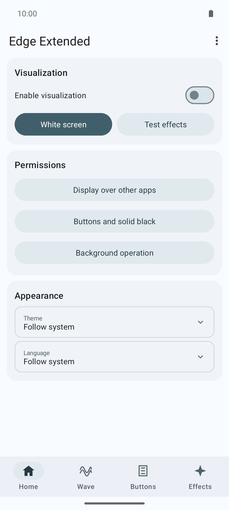
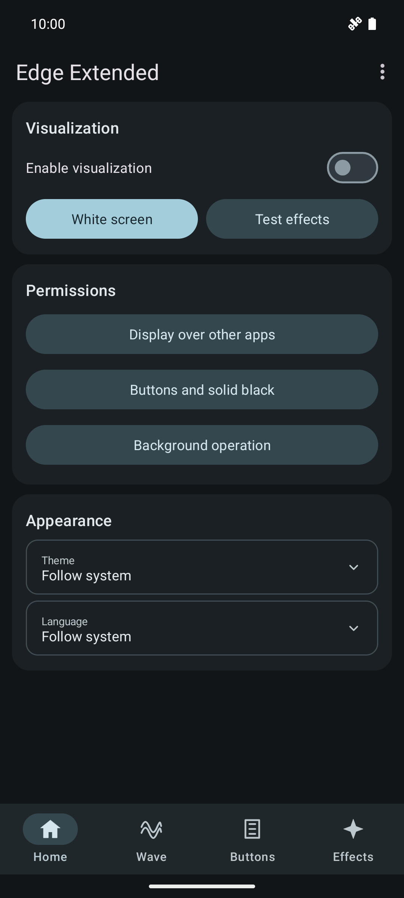
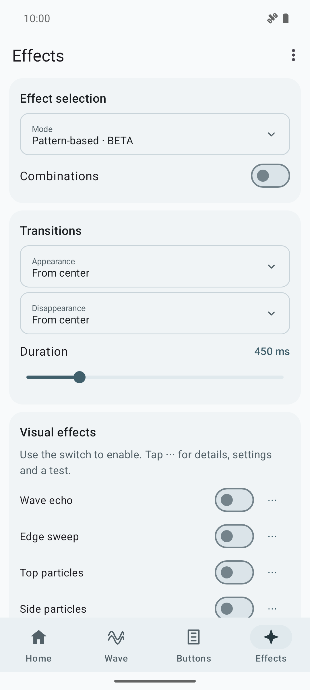
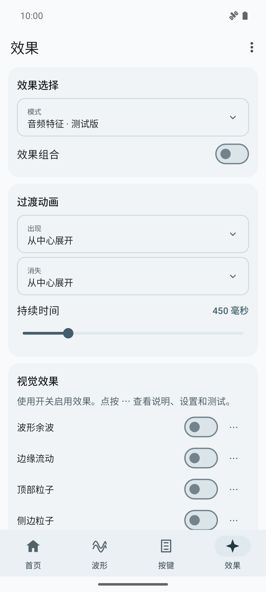

<div align="center">

# Edge Extended

**Music-reactive waves, particles and edge animations for Android.**

[](https://github.com/FASTDROPX/Edge-Extended/releases/latest)
[](https://github.com/FASTDROPX/Edge-Extended/releases/latest)
[](LICENSE)
[](https://github.com/FASTDROPX/Edge-Extended/actions)

[Download APK](https://github.com/FASTDROPX/Edge-Extended/releases/latest) · [Русское описание](docs/README.ru.md) · [Report a bug](https://github.com/FASTDROPX/Edge-Extended/issues)

</div>

## Screenshots

<table><tr><td></td><td></td></tr></table>

<table><tr><td></td><td></td></tr></table>

Captured from the release APK on an Android 15 (API 35) Pixel 6 emulator. See [capture details](docs/SCREENSHOTS.md).

## Features

- Three-layer smooth wave with Classic, Live and Classic + Live motion.
- Ten optional visual effects: wave echo, moving edge accents, particles, side and bottom pulses, outline echo, strings and frequency duet.
- Volume-button dents that remain while a key is held, including volume down at zero and volume up at maximum.
- **Beat-based** effect selection and experimental **pattern-based BETA** analysis.
- Independent appearance/disappearance transitions, adjustable geometry and fullscreen visual tests.
- Material 3 Expressive interface with light, dark and system themes.
- English, Russian, Simplified Chinese, French and German; language can be selected in the app or followed from the system.
- Optional local BPM memory per track.

**Everything is off on a fresh installation**, including effect combinations and volume-button animations. The app starts only when you enable it. Saved choices are retained when updating.

## Getting started

1. Install the APK from [Releases](https://github.com/FASTDROPX/Edge-Extended/releases/latest).
2. Enable visualization on Home and grant the requested overlay/audio permissions.
3. Select effects on the **Effects** tab. Tap **⋯** beside an effect for its description, settings and test.
4. To use held volume-button animations or fully opaque, touch-through black effects, enable the button accessibility service in Android settings. The button-animation switch is separate and starts off.
5. If your device stops the app in the background, review its battery/background restrictions. Some Android versions require **App info → menu → Allow restricted settings** before enabling a sideloaded accessibility service.

Use **Appearance** or the top-right menu for theme and language. The GitHub item opens this repository. Frequency duet height arrangements can be fixed or alternated from its **⋯** menu.

## Permissions and privacy

| Access | Purpose |
|---|---|
| Display over other apps | Draw the visualization above other applications. |
| Audio / `RECORD_AUDIO` | Required by Android's output `Visualizer` API. The app does not open the microphone. |
| Button accessibility service — optional | Observe volume-key press/release events and provide an opaque touch-through overlay. Screen-content retrieval is disabled. |
| Notification access — optional | Read media-session metadata for per-track BPM memory. Ordinary notification contents are not inspected. |
| Foreground-service notification | Keep a user-enabled visualization running and provide a stop action. |

Analysis and settings stay on the device. There is no network permission, analytics, audio recording or screen capture. Opening GitHub launches your browser.

## Known limitations

- Output Visualizer availability, frequency resolution and capture rate depend on Android, the device and the player. Fast hits can be missed.
- Pattern mode is **BETA**, based on DSP heuristics. It does not separate instruments or reliably understand every buildup/drop. Noisy bass, vocals and snares may be confused.
- Strings, frequency duet and wave echo share one upper-effect slot. An animation finishes before a different family starts; stale requests may be discarded. Repeated copies within wave echo are allowed for rolls.
- Android limits the fallback application-overlay opacity to 0.8. Use the optional button service for fully black touch-through rendering. Antialiasing and intentional exit fades still apply.
- BPM can be ambiguous on complex or free rhythms. The estimate is locked after a stable initial analysis; optional track access allows local reuse.

The sound laboratory and embedded settings-screen preview are not part of this release. Standalone visual tests remain available.

## Build and test

Requires **JDK 17**, **Android SDK 35**, and Build Tools **35.0.0**. Gradle 8.10.2 is included through the wrapper.

```sh
# Set ANDROID_HOME, or provide sdk.dir in an untracked local.properties.
./gradlew assembleDebug lintDebug testDebugUnitTest
./gradlew assembleRelease lintRelease
```

`assembleRelease` produces an unsigned APK. Sign it with your own private key using Android Build Tools `zipalign` and `apksigner`; the published APK uses a dedicated release key. Builds signed with a different key cannot update it. Private signing material is not included in this repository. The release build is not debuggable.

The historical application ID `dev.edgewave` is retained for update compatibility. The displayed application and public project name are **Edge Extended**.

See [BUILDING](docs/BUILDING.md) for APK locations, signing commands and Windows notes.

Tests cover effect rendering, interaction, defaults, translations, themes, both selectors, BPM, rhythm detection, queues and scene limits. Synthetic PCM fixtures are test-only; no commercial music or audio assets are included. See [CONTRIBUTING](CONTRIBUTING.md).

## License

[MIT](LICENSE) © 2026 FASTDROPX. Third-party components retain their own licenses; see [THIRD_PARTY_NOTICES](THIRD_PARTY_NOTICES.md).
