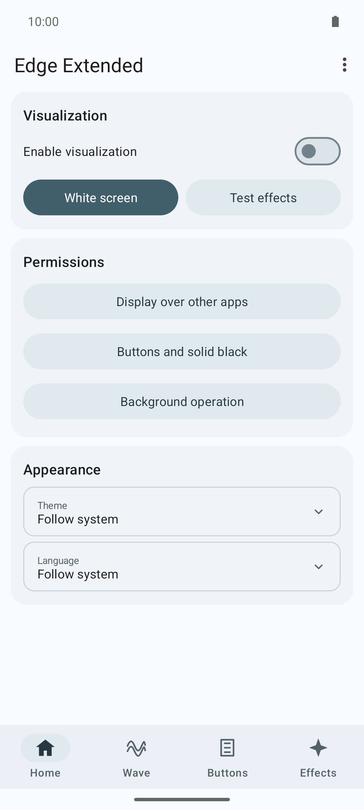
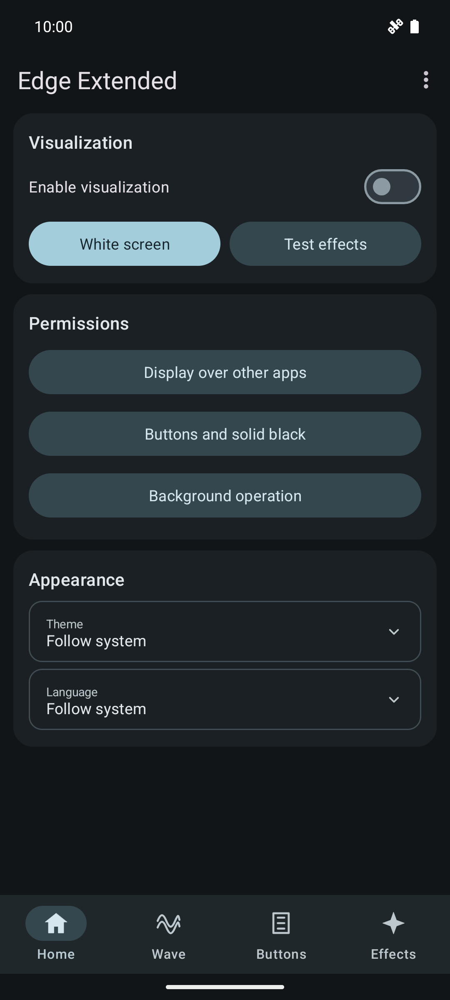
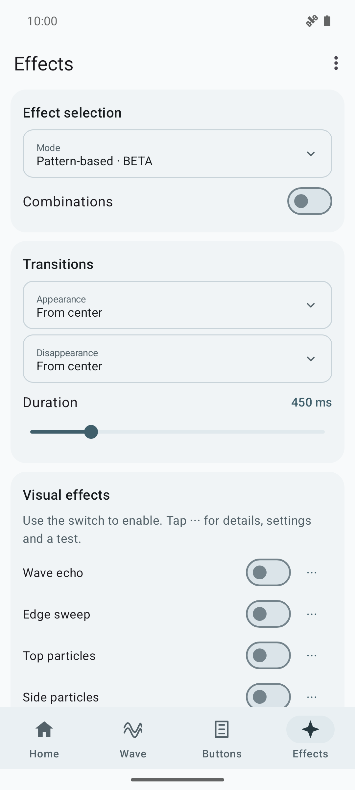
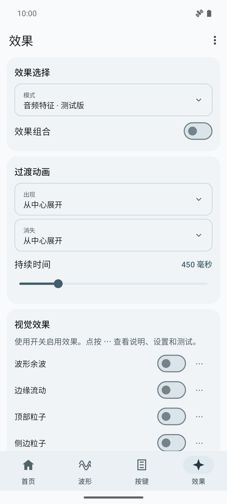

<div align="center">

# Edge Extended 1.0

Визуализация музыки у краёв экрана Android: плавная трёхслойная волна, частицы, контуры и анимации кнопок громкости.

[Скачать APK](https://github.com/FASTDROPX/Edge-Extended/releases/latest) · [Основное описание](../README.md) · [Сообщить об ошибке](https://github.com/FASTDROPX/Edge-Extended/issues)

[](https://github.com/FASTDROPX/Edge-Extended/releases/latest)
[](https://github.com/FASTDROPX/Edge-Extended/releases/latest)
[](../LICENSE)

</div>

## Скриншоты

<table><tr><td></td><td></td></tr><tr><td></td><td></td></tr></table>

Сняты с релизного APK на эмуляторе Pixel 6 с Android 15. [Подробности](SCREENSHOTS.md).

## Возможности

- Android 10+; Material 3, светлая/тёмная/системная тема.
- Русский, английский, упрощённый китайский, французский и немецкий. Язык выбирается в приложении.
- Десять эффектов с индивидуальными настройками и тестами.
- Подбор по битам и экспериментальный подбор по паттернам, помеченный БЕТА.
- Вырез камеры, положение кнопок и нижняя граница настраиваются.
- На чистой установке всё выключено, включая эффекты, комбинации и анимации кнопок. Сохранённые настройки при обновлении не сбрасываются.

## Использование

На Главной включить визуализацию, выдать доступ к наложению и аудиовизуализатору. Выбрать эффекты на вкладке Эффекты. Кнопка «⋯» открывает описание, параметры и тест. Для Дуэта можно выбрать фиксированную или чередующуюся высоту сторон.

Для удержания анимаций физических кнопок и полностью чёрного проходного слоя включить службу кнопок в настройках Android. Переключатель самой анимации включается отдельно. Служба не читает содержимое экрана и не меняет обычное действие клавиш.

Предпросмотр внутри настроек и звуковая лаборатория удалены. Отдельные визуальные тесты и белый экран сохранены. В меню справа сверху есть GitHub, тема и язык.

## Ограничения

Поддержка и частота кадров Android Visualizer зависят от устройства и плеера. Режим паттернов — DSP-эвристики, а не надёжное понимание структуры песни: возможны пропуски и ложные срабатывания на вокале, шумном басе и дробях.

Три верхних семейства доигрывают по очереди; устаревшие заявки могут отбрасываться. Резервное наложение Android имеет непрозрачность 0,8; для непрозрачной чёрной графики нужна служба кнопок.

Микрофон не открывается, звук и экран не записываются, сети и аналитики нет. Разрешение RECORD_AUDIO требуется системному API вывода. Необязательный доступ к уведомлениям используется для метаданных медиасессий и локальной памяти BPM.

## Сборка

JDK 17, SDK 35, Build Tools 35.0.0. Указать ANDROID_HOME или sdk.dir в local.properties:

```sh
./gradlew assembleDebug lintDebug testDebugUnitTest
./gradlew assembleRelease lintRelease
```

`assembleRelease` создаёт неподписанный APK. Перед установкой его нужно выровнять через `zipalign` и подписать своим ключом через `apksigner`. Опубликованный APK подписан отдельным ключом релиза, не является отладочным и использует пакет `dev.edgewave`. Сборка с другим ключом не установится поверх него. Приватный ключ в исходники не включён. [Инструкция по подписи](BUILDING.md).

Лицензия [MIT](../LICENSE). Инструкции для участников — [CONTRIBUTING](../CONTRIBUTING.md).
